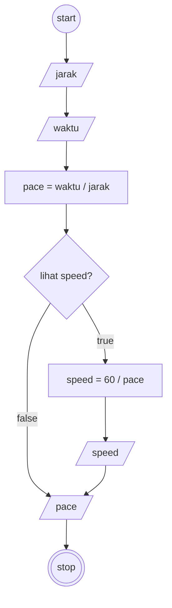

# Algoritma Implementasi

## Program: Kecepatan Lari

### Deskriptif
1. Mulai
2. Masukkan jarak lari (dalam km)
3. Masukkan waktu lari (dalam menit)
4. Hitung kecepatan lari (pace) dengan membagi waktu lari dengan jarak lari
5. Apabila ingin melihat kecepatan lari di treadmill (speed), maka hitung speed, jika tidak maka hanya tampilkan pace
6. Hitung speed dengan membagi 60 dengan pace
7. Tampilkan pace dan speed
6. Selesai

### Flowchart

### Pseudocode

    INPUT jarak             // satuan km - REAL
    INPUT waktu             // satuan min - INTEGER
    DECLARE pace : REAL     // satuan min/km
    DECLARE speed : REAL    // satuan km/jam

    pace <- waktu / jarak

    INPUT lihatSpeed        // BOOLEAN
    IF lihatSpeed = TRUE THEN
        speed <- 60 / pace
        OUTPUT "Speed: ", speed, " dan Pace: ", pace
    ELSE
        OUTPUT "Pace: ", pace
    ENDIF