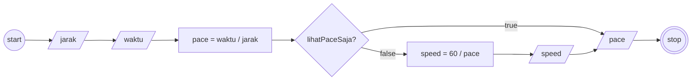

# Materi: Implementasi Algoritma

## Program: Kecepatan Lari

### Deskriptif
1. Mulai
2. Masukkan jarak lari (dalam km)
3. Masukkan waktu lari (dalam menit)
4. Hitung kecepatan lari (pace) dengan membagi waktu lari dengan jarak lari
5. Apabila hanya ingin lihat pace saja, maka tampilkan pace
6. Hitung kecepatan lari di treadmill (speed) dengan membagi 60 dengan pace
7. Tampilkan pace dan speed
6. Selesai

### Flowchart

### Pseudocode

    DECLARE jarak : REAL            // satuan km
    DECLARE waktu : REAL            // satuan min
    DECLARE pace : REAL             // satuan min/km
    DECLARE speed : REAL            // satuan km/jam
    DECLARE lihatPaceSaja : BOOLEAN
    INPUT jarak
    INPUT waktu
    INPUT lihatSpeed

    pace <- waktu / jarak

    IF lihatPaceSaja = TRUE THEN
        OUTPUT pace
    ELSE
        speed <- 60 / pace
        OUTPUT speed, pace
    ENDIF
